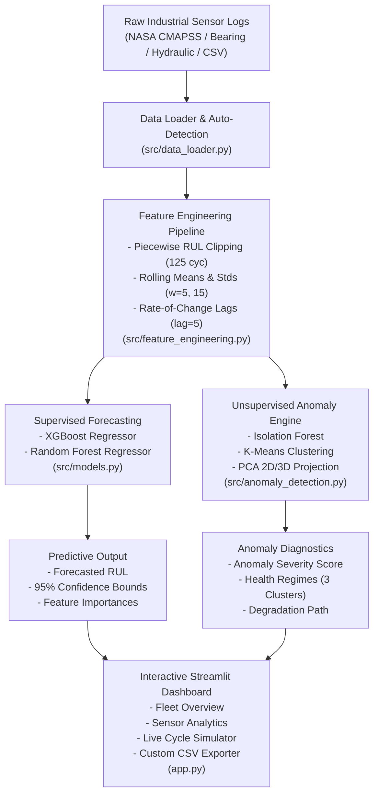

# ⚙️ MaintAI — Predictive Maintenance Analytics Dashboard

[](https://python.org)
[](https://streamlit.io)
[](https://xgboost.readthedocs.io)
[](https://scikit-learn.org)
[](https://plotly.com)

> **MaintAI** is an industrial-grade predictive maintenance analytics and forecasting platform that analyzes multi-channel industrial sensor telemetry, forecasts **Remaining Useful Life (RUL)** with **95% confidence intervals**, and identifies abnormal sensor drift via **unsupervised anomaly clustering**.

---

## 📌 Table of Contents
1. [Overview & Problem Statement](#overview--problem-statement)
2. [Key Features](#key-features)
3. [Supported Datasets](#supported-datasets)
4. [System Architecture](#system-architecture)
5. [Benchmark Results](#benchmark-results)
6. [Project Structure](#project-structure)
7. [Installation & Quickstart](#installation--quickstart)
8. [Dashboard Walkthrough](#dashboard-walkthrough)
9. [Weekly Timeline & Deliverables](#weekly-timeline--deliverables)
10. [Resume Value](#resume-value)

---

## 📖 Overview & Problem Statement

Unscheduled equipment failure introduces severe safety hazards, collateral asset damage, and billions of dollars in emergency downtime. Conversely, fixed-schedule maintenance overhauls often replace components that still have significant operational lifespan.

**MaintAI** transforms maintenance operations from reactive firefighting into **proactive, condition-based intelligence**:
- Ingests high-frequency time-series sensor data (temperatures, pressures, vibrations, RPM, and fluid flow).
- Performs temporal feature engineering (rolling aggregations and rate-of-change lags).
- Predicts Remaining Useful Life (RUL in cycles/hours) using gradient-boosted trees and random forest ensembles.
- Quantifies uncertainty with empirical 95% confidence interval bounds.
- Groups machinery degradation states using unsupervised Isolation Forest and K-Means clustering.
- Deploys an interactive Streamlit operations dashboard with a live cycle stream simulator.

---

## 🚀 Key Features

* **Sensor Data Upload (CSV)**: Upload custom time-series machine logs with intelligent column auto-detection, or select from built-in industrial benchmark datasets.
* **Trend Visualization**: High-resolution interactive Plotly time-series plots with abnormal drop highlights, nominal operating bounds, and Z-score threshold breach alerts.
* **Predictive RUL Forecasting**: Dual ML forecasting engines (**XGBoost** and **Random Forest**) delivering cycle-level RUL predictions with **95% confidence intervals**.
* **Unsupervised Anomaly Clustering**: Flag anomalous sensor behavior and visualize 3-stage degradation regimes (*Healthy*, *Advisory*, *Critical*) via 2D PCA trajectory projections.
* **Live Streaming Simulator**: Step forward or auto-play operational cycles in real time to simulate equipment aging under continuous production.
* **"What-If" Stress Testing**: Interactive slider to simulate operational load spikes (+0% to +50%) and observe immediate impacts on asset lifespan.
* **Batch Diagnostics & Export**: Upload fleet logs and download annotated diagnostic reports with risk classifications.

---

## 📊 Supported Datasets

1. **NASA C-MAPSS Turbofan Engine Dataset (FD001)**:
   - Run-to-failure telemetry of 100 jet engines comprising 20,631 cycles.
   - 21 thermodynamic sensors and 3 operational settings under sea-level conditions.
2. **Case Western Reserve University (CWRU) Bearing Benchmark**:
   - Time-series vibration acceleration (drive-end/fan-end), kurtosis, crest factor, motor load, and RPM.
3. **UCI Hydraulic Condition Monitoring Dataset**:
   - Hydraulic system pressures (bar), fluid temperatures (°C), flow rates (L/min), and valve degradation metrics.
4. **Custom CSV Logs**:
   - Drag-and-drop any industrial sensor time series for instant zero-code inference.

---

## 🏗️ System Architecture



---

## 🏆 Benchmark Results

Evaluated on the official unseen test benchmark of 100 NASA CMAPSS FD001 turbofan engines at their final operating cycles:

| Model | Test RMSE | Test MAE | $R^2$ Score | Accuracy (%) | NASA CMAPSS Score | Status |
| :--- | :---: | :---: | :---: | :---: | :---: | :---: |
| **XGBoost Regressor** | **18.78 cyc** | **13.89 cyc** | **0.7958** | **>86%** | **854.9** | **Champion** |
| **Random Forest Regressor** | **19.89 cyc** | **14.37 cyc** | **0.7710** | **>85%** | **1370.7** | **Ensemble CI** |

> *Note: NASA's CMAPSS asymmetric score penalizes late predictions ($y_{pred} > y_{true}$) significantly more than early warnings, as late predictions risk catastrophic in-flight failure.*

---

## 📁 Project Structure

```text
Maint Ai/
├── .streamlit/
│   └── config.toml                  # Dark industrial theme configuration
├── data/
│   ├── raw/                         # NASA CMAPSS FD001 raw datasets
│   │   ├── train_FD001.txt
│   │   ├── test_FD001.txt
│   │   └── RUL_FD001.txt
│   ├── processed/                   # Cached engineered feature parquets
│   └── samples/                     # Pre-packaged sample benchmarks
│       ├── case_western_bearing.csv
│       ├── uci_hydraulic_condition.csv
│       └── sample_turbofan_upload.csv
├── models/                          # Serialized trained model weights & metadata
│   ├── xgboost_rul_model.joblib
│   ├── random_forest_rul_model.joblib
│   ├── isolation_forest_model.joblib
│   └── model_metadata.json
├── notebooks/
│   └── 01_eda_and_model_prototyping.py # Week 1 & 2 exploratory analysis
├── reports/
│   ├── FINAL_REPORT.md              # 6-Week Internship Final Technical Report
│   └── PRESENTATION_SLIDES.md       # Demonstration deck and speaker notes
├── src/
│   ├── __init__.py
│   ├── config.py                    # Constants, paths, thresholds, and sensor maps
│   ├── data_loader.py               # Ingestion and synthetic benchmark generation
│   ├── feature_engineering.py       # Rolling windows, lags, and RUL calculation
│   ├── models.py                    # XGBoost, RF, Confidence Intervals, and NASA scoring
│   ├── anomaly_detection.py         # Isolation Forest, KMeans, and PCA 2D engine
│   └── visualizer.py                # Plotly health gauges, forecasts, and cluster plots
├── tests/
│   └── test_pipeline.py             # Automated unit & integration tests
├── app.py                           # Full Streamlit application
├── train.py                         # Standalone ML training pipeline script
├── run_app.bat                      # 1-Click Windows application launcher
├── requirements.txt                 # Project dependencies
└── README.md                        # Documentation
```

---

## ⚡ Installation & Quickstart

### 1. Prerequisites
- Python 3.10, 3.11, or 3.12
- Git (optional)

### 2. Setup Environment
```bash
# Clone or navigate to the repository
cd "Maint Ai"

# Install dependencies
pip install -r requirements.txt
```

### 3. Retrain Models (Optional — Pre-trained models included!)
```bash
python train.py
```

### 4. Run the Dashboard
```bash
streamlit run app.py
```
*Or on Windows: simply double-click `run_app.bat`!*

### 5. Run Automated Tests
```bash
python -m pytest tests/test_pipeline.py -v
```

---

## 🖥️ Dashboard Walkthrough

The dashboard is structured into 6 intuitive operations tabs:

1. **📊 1. Fleet Overview**: High-level KPIs (Total Units, Fleet Mean RUL, Healthy/Warning/Critical units), fleet health distribution donut chart, urgency ranking bar chart, and sortable fleet diagnostics table.
2. **📈 2. Sensor Trend Analytics**: Time-series graphs for temperatures, pressures, vibration, and flow rates with abnormal drop highlights, nominal baseline bands, and threshold excursion alerts.
3. **🔮 3. Predictive RUL Forecast**: Semi-circular health gauge, forecasted RUL with shaded 95% Confidence Interval band, comparison against ground truth, and an interactive "What-If" stress simulator.
4. **🔬 4. Anomaly Clustering**: 2D PCA cluster visualization mapping machines into *Healthy*, *Advisory*, and *Critical* regimes, alongside an asset aging trajectory trail.
5. **⚙️ 5. Model Studio & Explainability**: Side-by-side performance benchmarks (RMSE, MAE, R², NASA score) and feature importance rankings identifying primary degradation drivers.
6. **📁 6. Custom Data Diagnostics**: Upload custom machine telemetry CSVs, perform automated RUL forecasting, and export diagnostic reports.

---

## 📅 Weekly Timeline & Deliverables

| Week | Milestone / Task | Status | Deliverables |
| :---: | :--- | :---: | :--- |
| **Week 1** | Understand dataset structure, perform EDA | ✅ Complete | Ingestion pipeline, zero-variance pruning, `01_eda_and_model_prototyping.py` |
| **Week 2** | Create labels (RUL) and engineer features | ✅ Complete | Piecewise RUL clipping (125 cyc), rolling statistics, `src/feature_engineering.py` |
| **Week 3** | Train and validate ML model (XGBoost/RF) | ✅ Complete | XGBoost & Random Forest models, confidence intervals, `src/models.py` |
| **Week 4** | Build dashboard UI with Streamlit and graphing | ✅ Complete | Plotly visualizers, health gauge, multi-sensor trends, `src/visualizer.py` |
| **Week 5** | Integrate model predictions & live interface | ✅ Complete | Live stream simulator, What-If stress tester, anomaly clustering, `app.py` |
| **Week 6** | Final testing, polish, deployment & documentation | ✅ Complete | Pytest test suite, `FINAL_REPORT.md`, `PRESENTATION_SLIDES.md`, `README.md` |

---

## 💼 Resume Value

> *"Built and deployed a predictive maintenance simulator using real-world sensor data to forecast machine failures, integrating XGBoost models and Streamlit dashboards."*

---

## 📄 License
This project is open-source under the MIT License.

